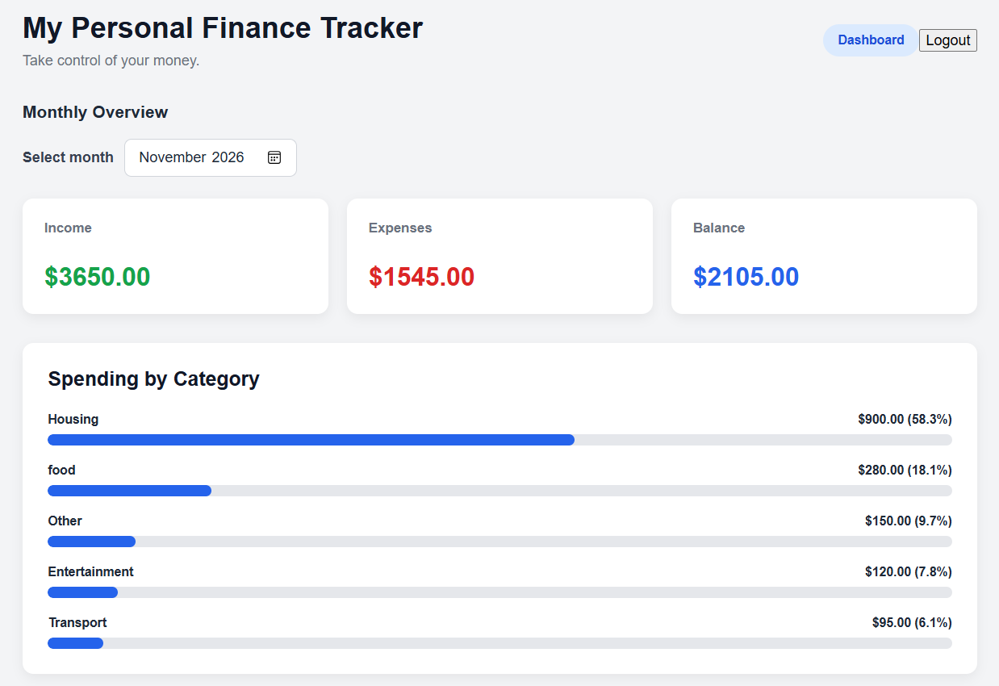
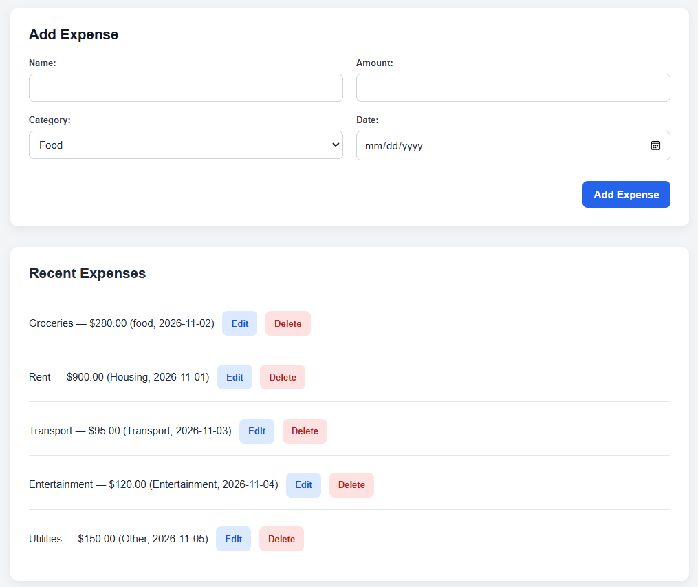
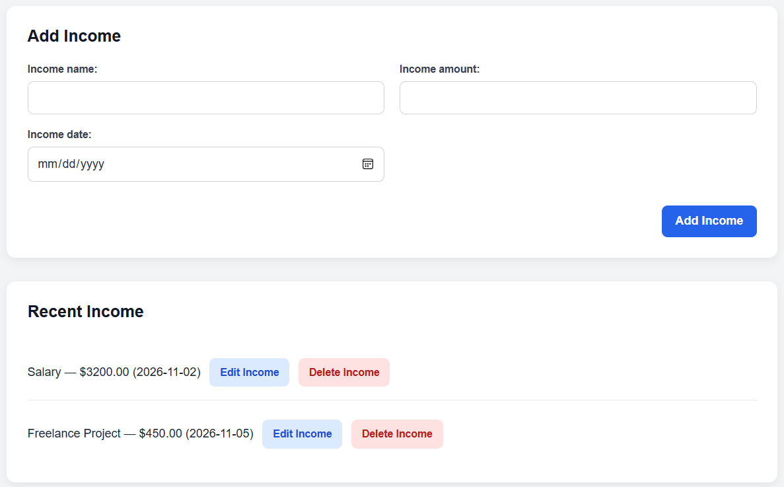

# Personal Finance Tracker

A full-stack web application for managing personal income and expenses, built with **React, TypeScript, Python, FastAPI, and SQLAlchemy**.

The application provides authenticated users with a way to record financial transactions, organize expenses, and monitor their finances through a responsive web interface.

**Live application:** https://personal-finance-tracker-ac7w.onrender.com

**API documentation:** https://personal-finance-api-m6we.onrender.com/docs

## Application Preview

### Financial Dashboard



_Monthly financial overview with income, expenses, balance, and spending breakdown. All financial data shown is fictional._

### Expense Management



_Create, view, edit, and delete expenses with categories, amounts, and dates._

### Income Management



_Track income sources and manage income records through the application interface._

## Features

### Authentication and security

- User registration and login.
- Token-based authentication for protected API endpoints.
- User-specific income and expense records.
- Access controls preventing users from viewing or modifying another user's transactions.

### Expense management

- Create, view, update, and delete expenses.
- Organize expenses using categories.
- Validate transaction names, amounts, and dates.
- Prevent future-dated expenses.

### Income management

- Create, view, update, and delete income records.
- Track income sources and amounts.
- Validate income data and prevent future-dated transactions.

### User interface

- Responsive React and TypeScript frontend.
- Forms for adding and editing financial records.
- Transaction lists with edit and delete actions.
- Date input restrictions and client-side validation.
- Integration with the FastAPI backend.

### Testing and deployment

- 26 automated backend tests.
- 13 automated frontend tests.
- GitHub Actions workflow for continuous integration.
- Frontend and backend deployed on Render.
- PostgreSQL database hosted on Neon.

## Technology Stack

| Area                   | Technologies                   |
| ---------------------- | ------------------------------ |
| Frontend               | React, TypeScript, Vite, CSS   |
| Backend                | Python, FastAPI, Pydantic      |
| Database               | PostgreSQL, SQLite, SQLAlchemy |
| Authentication         | Token-based authentication     |
| Backend testing        | pytest, FastAPI TestClient     |
| Frontend testing       | Vitest, React Testing Library  |
| Version control and CI | Git, GitHub, GitHub Actions    |
| Deployment             | Render, Neon PostgreSQL        |

## Architecture

The application uses a client-server architecture:

```text
    React + TypeScript frontend
          |
          | HTTP / REST API
          v
      FastAPI backend
          |
          | SQLAlchemy ORM
          v
    Relational database
    SQLite (local default)
    PostgreSQL (production)
```

The frontend communicates with the backend through REST API requests. The backend handles authentication, validation, business logic, and database access.

User-specific access controls help ensure that authenticated users can manage only their own financial records.

## Local Development

### Prerequisites

- Python 3.11
- Node.js and npm
- Git

### 1. Clone the repository

```powershell
git clone https://github.com/MadalinaRVeliche/PersonalFinanceTracker.git
cd PersonalFinanceTracker
```

### 2. Set up the backend

Create and activate a Python virtual environment:

```powershell
python -m venv .venv
.\.venv\Scripts\Activate.ps1
```

Install the Python dependencies:

```powershell
python -m pip install -r requirements.txt
```

By default, the backend uses a local SQLite database.

To use PostgreSQL, configure the `DATABASE_URL` environment variable with your own database connection string.

Start the backend:

```powershell
python -m uvicorn backend.main:app --reload
```

The backend runs at:

http://127.0.0.1:8000

Interactive API documentation:

http://127.0.0.1:8000/docs

### 3. Set up the frontend

Open a second PowerShell terminal:

```powershell
cd frontend
npm install
```

For local development, create `frontend/.env.local` with:

```env
VITE_API_URL=http://127.0.0.1:8000
```

Start the frontend development server:

```powershell
npm run dev
```

Open the local address displayed by Vite in your browser.

**Security note:** Do not commit `.env` files containing credentials, database connection strings, or other secrets.

## Automated Testing

### Backend

From the project root, with the virtual environment activated:

```powershell
python -m pytest -v
```

The backend test suite covers authentication, transaction management, validation, and user-specific access controls.

**Backend tests: 26 passing.**

### Frontend

From the `frontend` directory:

```powershell
npm test
```

The frontend uses Vitest and React Testing Library.

**Frontend tests: 13 passing.**

### Production build

```powershell
npm run build
```

The build process runs TypeScript compilation and generates production frontend assets.

## Continuous Integration and Deployment

The project includes a GitHub Actions workflow in `.github/workflows/tests.yml` to run automated checks.

The deployed application uses:

- **Render:** Frontend hosting
- **Render:** FastAPI backend hosting
- **Neon:** Managed PostgreSQL database

Application: https://personal-finance-tracker-ac7w.onrender.com

API documentation: https://personal-finance-api-m6we.onrender.com/docs

## Project Development

The project began as a browser-based HTML, CSS, and JavaScript expense tracker using LocalStorage.

It was subsequently developed into a full-stack application with:

- A React and TypeScript frontend.
- A Python and FastAPI backend.
- Relational database persistence.
- User authentication and data isolation.
- Automated testing and continuous integration.
- Cloud deployment.

The original browser-based prototype is retained in the repository as part of the project's development history.

## Potential Future Improvements

- Financial dashboard with charts.
- Monthly category budgets.
- Transaction search, filtering, and sorting.
- Financial reports and CSV export.
- Recurring income and expenses.
- More detailed inline validation messages.

## Challenges Faced and Solutions

### 1. Migrating from a browser-based prototype to a full-stack application

**Challenge:** The initial application stored expense data in browser LocalStorage, which did not support server-side persistence or user-specific access.

**Solution:** Rebuilt the application using a React and TypeScript frontend, FastAPI backend, and SQLAlchemy for database access. Integrated PostgreSQL for persistent production storage.

**What I learned:** How to design and connect a frontend, REST API, and relational database.

### 2. Implementing secure user-specific data access

**Challenge:** Financial records needed to be accessible only to their owners.

**Solution:** Implemented authenticated API endpoints and user-specific database queries. Added automated tests to verify that users cannot access or modify another user's income records.

**What I learned:** The importance of enforcing authorization on the backend rather than relying on frontend restrictions.

### 3. Preventing invalid transaction dates

**Challenge:** Users could enter future dates when creating or editing income and expense records.

**Solution:** Added Pydantic validation in the backend and date restrictions in the React frontend. Added automated tests for both creation and update operations.

**What I learned:** Why data validation should be enforced on both the client and server.

### 4. Fixing differences between test and production environments

**Challenge:** Frontend tests were affected by an environment configuration pointing API requests to the deployed backend instead of the expected local test URL.

**Solution:** Updated the Vite test configuration to use a predictable API URL during automated testing.

**What I learned:** How environment-specific configuration affects test reliability and why tests should be isolated from production services.

### 5. Preparing the application for cloud deployment

**Challenge:** The application needed to work with a hosted database and separately deployed frontend and backend services.

**Solution:** Configured database connections through environment variables, deployed the application on Render, and connected the backend to Neon PostgreSQL.

**What I learned:** How to configure and deploy a full-stack application using managed cloud services.

## Author

Developed as a full-stack software engineering portfolio project, demonstrating API development, frontend engineering, database integration, authentication, testing, and deployment.
